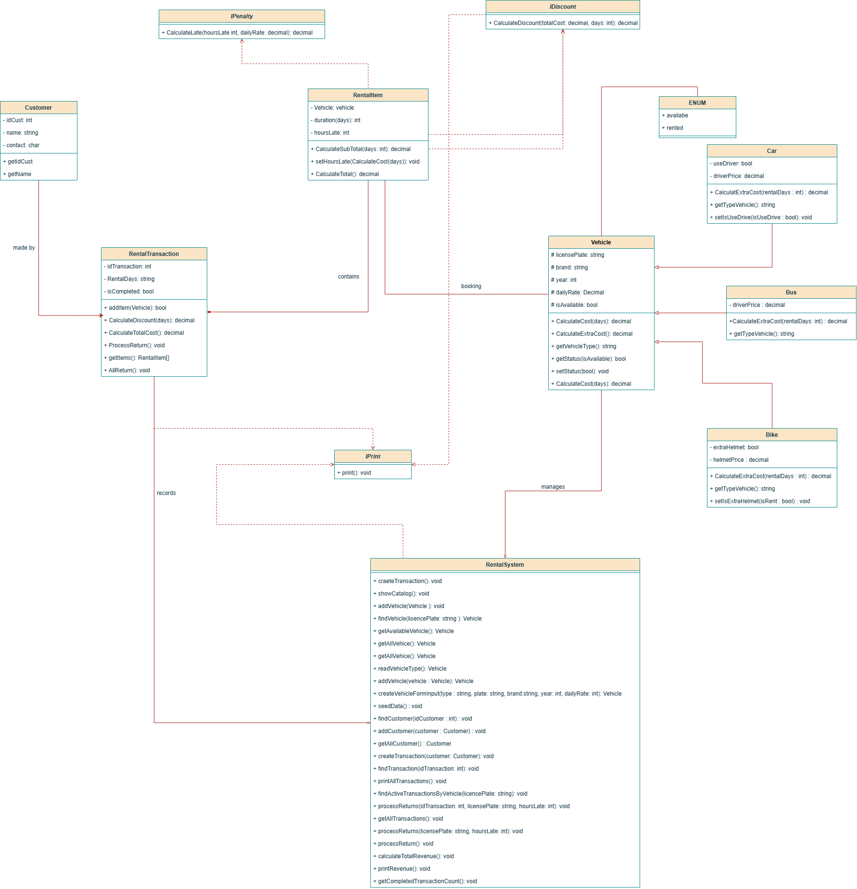

Farizal dan Afi

## Kasus 2 - Rental Kendaraan

Usaha rental kendaraan menyewakan mobil, motor, dan bus. Satu pelanggan bisa menyewa beberapa kendaraan dalam sastu transaksi.

### Kebutuhan Sistem
- Setiap kendaraan punya plat nomor yang tidak bisa diubah, merk, tahun, taruf harian (harus lebih dari 0), dan status tersedia atau disewa.
- Mobil boleh memakai sopir (150.000 per hari, opsional). Bus wajib memakai sopir (300.000 per hari). Motor tidak memakai sopir, tetapi bisa menyewa helm tambahan 10.000 per hari.
- Sewa minimal 7 hari mendapat diskon 10% dari biaya sewa kendaraan.
- Keterlambatan pengembalian didenda 10% tarif harian per jam, maksimal sebesar satu hari tarif.
- Kendaraan yang sedang disewa tidak bisa disewa lagi.
- Cetak invoice per transaksi dan daftar yang masih tersedia.

### Fitur Utama
- **Daftar kendaraan**: plat, merk, jenis, tarif harian, dan status. juga versi yang menampilkan kendaraan tersedia.
- **Buat transaksi**: Kendaraan berhasil ditambahkan, atau ditolak karena sedang disewa.
- **Invoice**: rincian per kendaraan (tarif x hari, sopir, heml), diskon sewa 7 hari, denda, dan total.
- **Pengembalian**: hitungan denda per jam beserta batas maksimalnya, lalu status kendaraan kembali tersedia.
- **Laporan**: Jumlah transaksi dan total pembayaran.
- **Pesan validasi**: misalnya tarif harian 0 atau negatif.

### Pembagian
- **Bagian A - Vehicle**: jenis-jenis kendaraan, beserta hitungan tarif dan sopir.
- **Bagian B - Customer & Rental**: data pelanggan, transaksi berisi beberapa kendaraan, diskon, denda, dan invoice
- **Fitur tambahan**: Laporan pendapatan per jenis kendaraan

